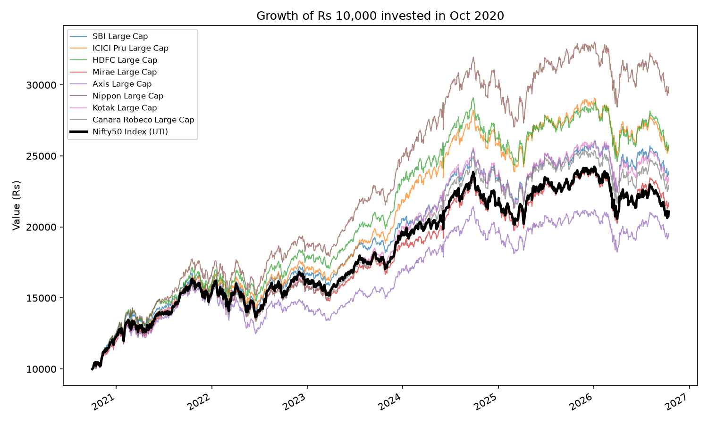
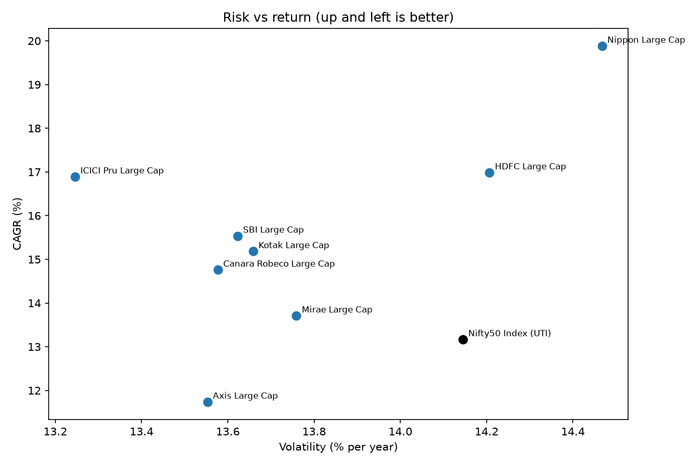
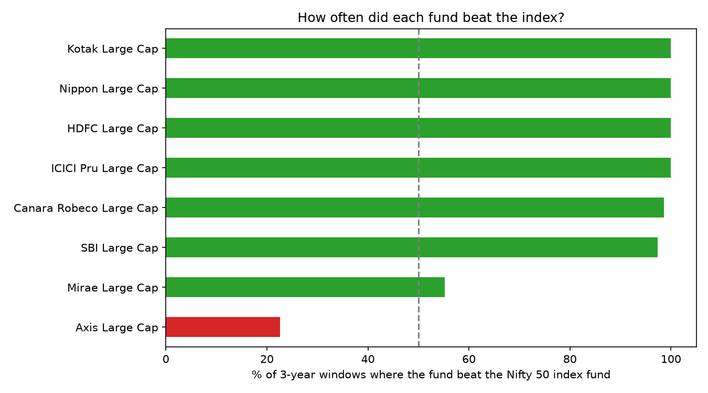

# Do Indian large-cap mutual funds beat a Nifty 50 index fund?

**Answer:** Over Oct 2020 – Oct 2026, **7 of 8** popular large-cap funds beat a Nifty 50 index fund, and they did it **without taking more risk**. But this covers one strong market cycle and only funds that survived, so it is not proof that active funds always win.

| | Best fund | Index fund | Worst fund |
|---|---|---|---|
| Fund | Nippon India Large Cap | UTI Nifty 50 Index | Axis Large Cap |
| Return (CAGR) | 19.9% | 13.2% | 11.7% |
| ₹10,000 became | ₹29,900 | ₹21,100 | ₹19,500 |
| Sharpe ratio | 0.93 | 0.47 | 0.39 |

---

## Why this question

An investor choosing a large-cap fund has two options: pay a higher fee for an active fund manager, or buy a low-cost index fund. The question is whether the active managers earned that fee, after accounting for risk.

## Charts

**What ₹10,000 became in each fund.** The thick black line is the index fund.



**Risk vs return.** All funds took similar risk (13–15% volatility), so the extra return was not bought with extra risk.



**How often each fund beat the index across every 3-year holding period.** This measures consistency, not a single lucky period.



## Full results

| Fund | CAGR | Volatility | Sharpe | Max drawdown | Beat rate (3-yr windows) |
|---|---|---|---|---|---|
| Nippon India Large Cap | 19.9% | 14.5% | 0.93 | -15.4% | 100% |
| HDFC Large Cap | 17.0% | 14.2% | 0.74 | -16.4% | 100% |
| ICICI Pru Large Cap | 16.9% | 13.2% | 0.78 | -15.4% | 100% |
| SBI Large Cap | 15.5% | 13.6% | 0.66 | -16.4% | 97.4% |
| Kotak Large Cap | 15.2% | 13.7% | 0.64 | -17.4% | 100% |
| Canara Robeco Large Cap | 14.8% | 13.6% | 0.61 | -17.3% | 98.6% |
| Mirae Asset Large Cap | 13.7% | 13.8% | 0.52 | -17.4% | 55.2% |
| **UTI Nifty 50 Index (benchmark)** | **13.2%** | **14.1%** | **0.47** | **-16.6%** | — |
| Axis Large Cap | 11.7% | 13.6% | 0.39 | -21.6% | 22.6% |

A formatted version is in [`output/summary_formatted.xlsx`](output/summary_formatted.xlsx).

## Method

- **Data:** daily NAVs from [mfapi.in](https://www.mfapi.in/), a free API over AMFI data. Direct Plan – Growth option for every fund, so fee structures are comparable.
- **Period:** 1 Oct 2020 – 13 Oct 2026 (6 years, about 1,500 trading days).
- **Metrics:**
  - **CAGR:** average yearly return
  - **Volatility:** standard deviation of daily returns × √252
  - **Sharpe ratio:** (CAGR − 6.5%) ÷ volatility. The 6.5% approximates the 91-day T-bill yield.
  - **Max drawdown:** the worst fall from a previous peak
  - **Beat rate:** the share of all rolling 3-year periods in which the fund's return beat the index fund's

## Limitations: why this result could be misleading

- **Survivorship bias.** I only picked funds that exist today. Funds that closed or merged after doing badly are missing, which flatters active funds.
- **Selection.** These are 8 large, well-known funds, not every large-cap fund. Funds often become well known *because* they did well.
- **One market cycle.** 6 years is short. The 3-year windows overlap heavily, so the 100% beat rates are far less impressive than they look.
- **Possible tilt, not skill.** SEBI lets large-cap funds hold up to 20% outside the top 100 stocks, and 2020–2026 was strong for mid and small caps. Part of the outperformance may come from that tilt rather than stock picking. *Not tested here.*
- **Benchmark.** I used an index fund, which carries its own small costs, not the pure Nifty 50 Total Return Index.
- **Ignored:** taxes, exit loads, and the timing effects of SIP (monthly) investing.

**Next step if I extended this:** compare against the Nifty 100 TRI, and run a regression on large-, mid- and small-cap index returns to separate tilt from skill.

## How to run it

```bash
py -m venv .venv
.venv/Scripts/python.exe -m pip install -r requirements.txt
cd python
../.venv/Scripts/python.exe 01_get_data.py    # downloads NAVs to data/navs.csv
../.venv/Scripts/python.exe 02_analyze.py     # writes output/summary.xlsx and 3 charts
```

## Files

```
python/01_get_data.py      download daily NAVs for 9 funds
python/02_analyze.py       metrics, beat rate, charts, Excel export
data/navs.csv              the downloaded NAV data
output/                    charts and Excel summary
```

*Tools: Python (pandas, matplotlib), Excel. Not investment advice.*
